<div align="center">



<a href="https://github.com/MashrurAmd?tab=followers"></a>




</div>



```yaml
player:   Mashrur Ahmed
class:    Game Developer
guild:    BRAC University · Computer Science & Engineering
engines:  [Unity, Unreal Engine, Roblox Studio, Godot]
quests:   [multiplayer card games, 3D action, racing, arcade classics]
ships_to: [Android, iOS, PC, WebGL]
status:   building the next world  ▰▰▰▰▰▰▰▱▱▱  70%
```

- 🎮 I build games in **Unity**, **Unreal Engine** and **Roblox Studio**, from mobile card games to 3D fighters.
- 🌐 I like the hard parts of multiplayer: lobbies, matchmaking and keeping every client in sync.
- 📱 I take games all the way to the store, with builds, IAP, ads, sign-in and store listings.
- 🛠️ Right now I'm working on online board and card games.



**[Trump & Trick](https://mashruramd.github.io/trump-trick-site/)**: a 2–4 player trick-taking card game with local and online multiplayer, Google or guest sign-in and rewarded ads.<br/>
  

**[Danger Zone](https://mashruramd.github.io/dangerzone-privacy/)**: a mobile game with player accounts, live in the stores.<br/>
 

**[TEKKEN-2077](https://github.com/MashrurAmd/TEKKEN-2077)**: a 3D fighting game project in Unity.<br/>
 

**[Mad Car Racing](https://github.com/MashrurAmd/MadCarRacing-)**: a racing game with roads and tracks built using Road Architect.<br/>
 

**[Vampire 3D](https://github.com/MashrurAmd/Vampire-3D-Prototpye)**: a 3D action prototype with a full player control and animation system.<br/>
 

**[Checkers](https://github.com/MashrurAmd/CHECKERS-GAME) · [Craps](https://github.com/MashrurAmd/CRAPS-GAME) · [2D Ball Game](https://github.com/MashrurAmd/2D-Ball-Game-CLIENT)**: classic board, dice and arcade games rebuilt in Unity.<br/>
 

More in the [repository vault ›](https://github.com/MashrurAmd?tab=repositories)



<div align="center">

</div>



<div align="center">


<br/>

<br/><br/>
<picture>
  <source media="(prefers-color-scheme: dark)" srcset="https://raw.githubusercontent.com/MashrurAmd/MashrurAmd/output/snake-dark.svg"/>
  <source media="(prefers-color-scheme: light)" srcset="https://raw.githubusercontent.com/MashrurAmd/MashrurAmd/output/snake.svg"/>
  
</picture>
</div>



<div align="center">

<a href="https://github.com/MashrurAmd"></a>
<a href="https://mashruramd.github.io/trump-trick-site/"></a>
<!-- Add more channels here, e.g. LinkedIn:
<a href="https://linkedin.com/in/YOUR_HANDLE"></a>
-->


</div>
